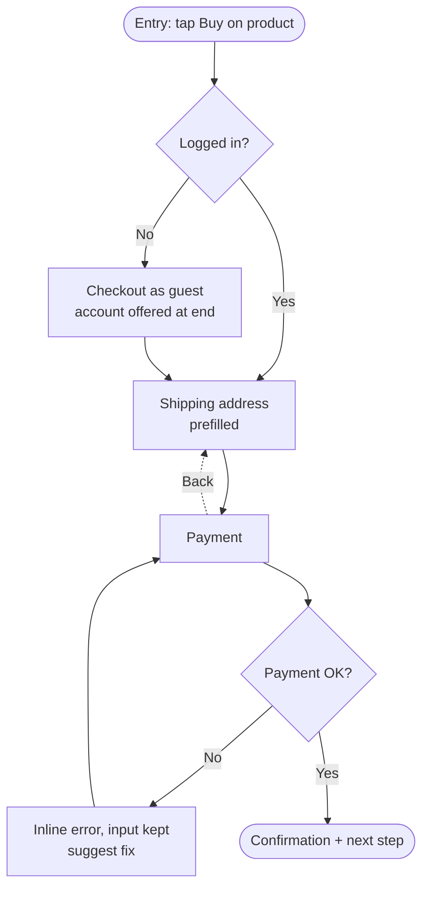

# UX & User Flows

A working method for the experience layer: who the user is, what they are trying to get done, the path they take, and every state and branch along it. It is distilled from the core UX literature: Norman, Krug, Nielsen/NN/g, Garrett, Yablonski's *Laws of UX*, Rosenfeld & Morville, Baymard, W3C WCAG 2.2 and Brignull.

Use it whenever you design, map or review a flow, a feature, a screen sequence, a form, onboarding, navigation or information architecture, in any medium (web, mobile, desktop, kiosk, conversational).

**Where it sits.** This skill decides *what happens and in what order*. **graphic-design-fundamentals** decides *how it looks*. **less-is-more** decides *what earns its place* on each screen. **impeccable** polishes and audits. When a project has a design system (DESIGN.md / AGENTS.md), its specifics win, for example its target size or its single accent action. On a screen or flow, run this skill first, then the others.

## How to use this skill

1. **Frame** the problem (section 1) before drawing anything.
2. Pick the **research and model** you actually need (sections 2 to 3). Don't do every method.
3. Write the **flow** (section 4). This is the core of the skill.
4. Apply the **interaction rules** for each step (sections 5 to 8).
5. Check **ethics and accessibility** (sections 9 to 10).
6. **Evaluate** (section 11) and run the **flow review checklist** (section 13) before delivering.
7. When explaining choices, name the principle (e.g. "moved account creation to confirmation, Baymard: forced accounts cause abandonment").

---

## 1. Frame the problem

Work through Garrett's five planes from the bottom up. Decide each plane before the one above it.

1. **Strategy:** business goal and user need. Why does this exist?
2. **Scope:** features and content requirements. What's in and what's out?
3. **Structure:** interaction design and information architecture. How do the parts connect? *(This skill lives mostly here.)*
4. **Skeleton:** interface, navigation and information design. Where do things go on a screen?
5. **Surface:** visual design (hand off to graphic-design-fundamentals).

Write a one-paragraph brief that states:
- the **actor** (a persona or user type, and only one per flow);
- the **job**, as a job story: *When [situation], I want to [motivation], so I can [expected outcome].* Prefer this to "As a user…", because the situation is what shapes the flow.
- **success**: what done looks like for the user and for the business, and how you'll measure it;
- **constraints**: platform, legal, technical, data available, and deadline;
- the **context of use**: device, environment, attention level (rushed? one-handed? interrupted?) and frequency (once? daily?).

If the actor, job or context is unknown and you can't reasonably infer it, ask before designing.

## 2. Research: match the method to the question

| Question | Method | Notes |
|---|---|---|
| What do people need, and why? | Interviews, contextual inquiry, field study | Ask about past behavior, not hypothetical futures |
| What do they actually do? | Analytics, session recordings, observation | Behavior beats opinion |
| How do they group our content? | **Card sorting** (open = discover groups; closed = fit to given groups) | Generative. It gives ideas, not the final IA |
| Can they find things in our structure? | **Tree testing** | Evaluative. Text-only hierarchy, no visual help |
| Can they complete the task? | **Usability testing** (moderated or not) | ~5 users per round finds ~85% of problems (Nielsen) |
| Which version performs better? | A/B test, first-click test | Needs traffic; tells you *what*, not *why* |
| Where are the obvious flaws, fast? | **Heuristic evaluation** (section 11) | 3 to 5 evaluators, each working independently |

Testing rules (Nielsen, Krug):
- Run several small rounds of about 5 users, with redesigns in between, rather than one big study. Three studies of 5 beat one study of 15.
- Distinct user groups need their own participants: 3 to 4 per group for two groups, at least 3 each for three or more.
- Testing one user is better than testing none. Test early, with sketches and paper prototypes.
- Fix by removing or simplifying before you add.

## 3. Model the experience

Pick the map that fits the question (NN/g):

| Map | Scope | Use it to |
|---|---|---|
| **Empathy map** | One user type. Says / Thinks / Feels / Does. Not sequenced in time | Align the team on who the user is, at the start |
| **Experience map** | A generic human reaching a goal, product-agnostic | Understand behavior before product decisions |
| **Customer journey map** | One actor, one scenario, one product, chronological | Find pain points and moments of delight across touchpoints; assign owners |
| **Service blueprint** | The organization's side: frontstage, backstage, support processes | Fix the internal breakpoints behind a bad touchpoint |
| **User story map** | A feature broken into steps and stories, by release | Plan scope and MVP slices |

**Journey map anatomy (NN/g):**
1. Actor (one point of view)
2. Scenario and expectations
3. Phases (e.g. Discover → Compare → Decide → Use → Get help)
4. Actions, mindsets and emotions per phase, with one emotion line showing highs and lows
5. Opportunities, each with an owner and a metric

Journey maps are for discovery, at a big-picture level. User flows (next section) are for design, step by step.

**Information architecture (Rosenfeld & Morville).** Design four systems:
- **organization:** how content is grouped (by task, topic, audience, time or alphabet);
- **labeling:** what things are called, in the user's words;
- **navigation:** how people move between groups;
- **search:** how people find things directly.

Label from user research, never from the org chart. Validate the IA with a tree test before visual design.

## 4. User flows (core)

### 4.1 Choose the right artifact

| Artifact | Shows | Use when |
|---|---|---|
| **Task flow** | One linear path for one task, no branches | Early alignment on the happy path |
| **User flow** | One actor's path to a goal, **with** entry points, decisions, branches, system states and exits | The main design and spec artifact |
| **Wireflow** | Low-fi screens connected by arrows, showing hotspots and what changes | Mobile apps, single-page apps, checkouts, filters, configurators: anywhere a screen changes in place (NN/g) |
| **Sitemap** | The page hierarchy, no behavior | IA overview for content-heavy sites |
| **State diagram** | The states of one object or component and the transitions between them | Complex components (upload, payment, sync, multi-state orders) |

### 4.2 Anatomy of a complete user flow

Every user flow states:

1. **Actor and goal**, as one job story.
2. **Entry points.** Every way in: direct, deep link, notification, email, search, a shared link, or returning mid-task. Flows rarely start at the home screen.
3. **Preconditions.** Logged in? Has data? First time or returning? Permissions granted?
4. **Steps.** Each is a screen or state, with the **user action** and the **system response**.
5. **Decisions.** System decisions (is the user logged in? is the card valid?) and user choices. Each branch is labeled.
6. **System states for each step.** Loading, empty, partial, error, success and offline (section 7).
7. **Unhappy paths.** Validation errors, failures, timeouts, permission denied, cancel, back, abandonment and resuming later.
8. **Exits.** Success and where it leads next, plus every way out. Each exit lands somewhere useful, with no dead ends.
9. **Notes.** Copy, data that's needed, analytics events, and open questions.

Design the happy path first, then walk every branch. Most UX bugs live in the branches.

### 4.3 Notation

Use standard flowchart shapes:
- rounded rectangle = start or end;
- rectangle = screen or step;
- diamond = decision;
- parallelogram = user input;
- arrow = transition, labeled with the action ("Tap Pay").

Mark the happy path visually, for example with a bold or accent line. Keep one actor and one goal per diagram, and link out to sub-flows instead of drawing everything at once.

In text or code, write flows as **Mermaid** so they render and can be versioned:

Then add a table with one row per step:

| # | Screen/state | User action | System response | States to design | Edge cases |
|---|---|---|---|---|---|

### 4.4 Flow design rules

- **Fewest meaningful steps, not fewest clicks.** Easy, unambiguous steps are cheap; steps that need thought are expensive (Krug). Remove steps; don't cram them together.
- **Ask only for what you need now.** Defer everything else (Baymard: delay account creation to confirmation; most checkouts need about 8 fields, not the average of about 11).
- **Defaults over questions.** Guess, show the guess, allow a one-tap fix.
- **Never ask twice.** Prefill anything already provided in the flow (WCAG 2.2 3.3.7 Redundant Entry).
- **Staged vs progressive disclosure (NN/g).** Use a wizard (staged) when steps are independent. Use progressive disclosure (core first, advanced on request) when they aren't. Keep progressive disclosure to **2 levels** at most.
- **Show progress in multi-step flows.** Use a step indicator, and say what's left. The goal-gradient effect means people speed up near the end, so don't put the hardest step last.
- **Make it interruptible.** Save state, allow resuming, and remind people of unfinished tasks (Zeigarnik).
- **Always offer a way back and a way out** (Nielsen #3, User control and freedom). Prefer **undo over confirm**. Confirm only actions that are destructive and can't be undone.
- **Every flow ends somewhere useful.** Confirmation, then the next likely action, or back where the user started.
- **Design the end and the peak.** People judge an experience by its most intense moment and its end (peak-end rule). Make the confirmation and the worst moment (an error, a wait) the best they can be.
- **Follow conventions** (Jakob's law). Users spend most of their time in other products, so innovate only where it clearly beats the convention.
- **Move complexity to the system** (Tesler's law). Some complexity can't be removed; the system should absorb it, not the user.

## 5. Interaction foundations

**Norman, *The Design of Everyday Things*:**
- **Signifiers** show where to act and how. Make actions visible, not merely possible.
- **Mapping:** controls relate spatially and logically to their effects.
- **Feedback:** every action gets an immediate, informative response.
- **Constraints:** physical, cultural, semantic and logical constraints prevent wrong actions. A forcing function blocks a dangerous step until a prerequisite is met.
- **Conceptual model:** the user should be able to predict what will happen.
- **Bridge the two gulfs.**
  - Execution: *how do I do what I want?* Answer it with signifiers, mapping and constraints.
  - Evaluation: *did it work?* Answer it with feedback and visible state.
- **Seven stages of action:** goal → plan → specify → perform → perceive → interpret → compare. At each step, the user must be able to answer the question that stage raises.
- **Slips vs mistakes.** A slip is the right plan, badly executed: prevent it with constraints and undo. A mistake is the wrong plan: prevent it with a clearer model and better information. Errors are design failures, not user failures.

**Krug, *Don't Make Me Think*:**
- Make things self-evident. Users scan, satisfice and muddle through.
- Use conventions. Cut words: remove half, then half again, and drop the "happy talk".
- **Trunk test.** From any inner page, the user can tell: what site this is, what page they're on, the major sections, where they are, and how to search.
- The **reservoir of goodwill.** Every hurdle drains it. Honesty, clarity and easy recovery refill it.

**Nielsen's 10 usability heuristics** (also the evaluation rubric, section 11):
1. Visibility of system status
2. Match between system and the real world
3. User control and freedom
4. Consistency and standards
5. Error prevention
6. Recognition rather than recall
7. Flexibility and efficiency of use
8. Aesthetic and minimalist design
9. Help users recognize, diagnose and recover from errors
10. Help and documentation

**Laws of UX (Yablonski), the ones that most often change a flow:**
- **Hick's law:** more, and more complex, choices make decisions slower. Cut, group or recommend.
- **Choice overload:** too many options paralyze. Give a default or a recommendation.
- **Fitts's law:** time to hit a target depends on its distance and size. Make primary targets big and near.
- **Miller's law / working memory:** don't make people hold things in mind across steps. Show the information they need where they need it.
- **Chunking:** break long input and long content into meaningful groups (card numbers, phone numbers, sections).
- **Cognitive load:** every element and decision has a mental cost.
- **Serial position effect:** people remember the first and last items best. Put key items at the ends of lists and navigation.
- **Von Restorff effect:** the different item is remembered. Use it for the primary action only.
- **Doherty threshold:** keep the system's responses under about 400 ms to keep the user in flow.
- **Postel's law:** accept input liberally (formats, spaces, case) and output clearly.
- **Aesthetic-usability effect:** good-looking designs are perceived as easier to use. This can mask problems in testing.
- **Paradox of the active user:** people never read manuals. Design for learning by doing.

## 6. Navigation and wayfinding

- At any point, the user knows where they are, where they can go, and how to get back (trunk test).
- Keep top-level navigation to a few task-based items, labeled in the user's words, consistent and in a stable order.
- **Mobile:** use a bottom tab bar for 3 to 5 top-level destinations. Avoid hiding primary destinations behind a hamburger menu. Back must always work as expected, including the system back gesture.
- Use breadcrumbs for deep hierarchies, and search for large content sets. Search results must help users recover from typos and zero results.
- Deep links and notifications must land on the right screen with context, not on the home screen.

## 7. States, feedback and timing

Design all of these for every screen and component in the flow:

| State | Design rule |
|---|---|
| **Ideal / populated** | The normal case |
| **Empty, first use** | Explain the value and give one clear action to start. Never a blank screen |
| **Empty, no results** | Say why, and offer a recovery (clear filters, fix spelling, suggestions) |
| **Loading** | Follow the timing limits below. Prefer skeletons for content and optimistic UI for quick actions |
| **Partial** | Some data has loaded or failed. Show what you have |
| **Error** | See section 8 |
| **Success** | Confirm what happened, and point to the next step |
| **Offline / degraded** | Say so. Queue actions and sync later where possible |
| **Permission / locked** | Say why, and how to get access |

**Response time limits (Nielsen):**
- **0.1 s** feels instant. Show the result, and highlight selections immediately.
- **1 s** keeps the flow of thought. Under 1 s needs no special feedback; above it, show that work is happening.
- **10 s** is the limit of attention. Beyond it, show a percent-done indicator, an estimate, and a **cancel**. For roughly 2 to 10 s, use a lighter "working" cue.

## 8. Forms, errors, onboarding and help

**Forms (NN/g, Baymard, Wroblewski):**
- **Shorten.** Remove fields you can derive, defer or drop.
- **One column**, with fields in a logical order. Tab order matches visual order.
- **Labels above or beside fields.** Never use placeholder text as the label.
- **Fit the control to the input.** Radio buttons for 2 to 3 options. Size fields to the expected entry. Use the right mobile keyboard (email, numeric, tel) and autocomplete attributes.
- **Mark optional fields** (keep them to one or two), and **state requirements up front**, such as password rules.
- Use one full-name field. Hide address line 2 and coupon fields behind links. Default billing to the shipping address. Use address lookup.
- **No Reset or Clear buttons.** Cancel is visually weaker than Submit.
- **Multi-step forms:** group by topic, show progress, save as you go.

**Errors (NN/g):**
- Validate **inline**, after the user leaves a field, not while they type.
- Put the error **next to the field**, and use more than color (an icon plus text). A summary is a supplement, never the only signal. Never put errors in tooltips.
- Write in plain language: what happened and how to fix it. Never blame the user, and never show codes alone.
- **Keep the user's input.** Never clear a form on error.
- If the same error repeats, give more help; it's a design problem.
- Prevent before reporting: use constraints, good defaults, forgiving formats and confirmation of costly actions.
- Use modals sparingly. They interrupt and add load.

**Onboarding and help (NN/g):**
- Avoid upfront tutorials and walkthroughs. They get skipped, forgotten, and they block users with a goal.
- Prefer **contextual help**, triggered by user signals at the moment of need. Make it easy to dismiss and easy to find again.
- Keep tutorials for genuinely novel interactions, make them hands-on (learn by doing), and make them revisitable.
- Ask for **permissions in context**, at the moment the feature needs them, after explaining the benefit. Never ask for everything at launch.
- Let people reach value before asking them to sign up, wherever possible.
- Help is searchable, concise, task-focused and placed where it's needed (heuristic #10).

## 9. Ethics: no deceptive patterns

Never design these (Brignull, deceptive.design). Flag them in reviews:
- sneaking;
- forced action;
- hard to cancel (cancelling must be as easy as signing up);
- preselection of options that benefit the business;
- obstruction;
- hidden subscriptions;
- hidden costs (Baymard: extra costs are the top reason people abandon checkout);
- trick wording;
- visual interference;
- fake social proof, fake urgency and fake scarcity;
- nagging;
- disguised ads;
- confirmshaming;
- comparison prevention;
- addictive design;
- currency confusion.

Persuade with clarity and honesty. Show the total cost early, and use plain opt-ins.

## 10. Accessibility in flows (WCAG 2.2)

Flow-level criteria to check, in addition to the visual rules in graphic-design-fundamentals:
- **2.4.11 Focus Not Obscured (AA):** sticky headers, cookie banners and sheets must not hide the focused element.
- **2.5.7 Dragging Movements (AA):** every drag action (reorder, slider, swipe-to-delete) needs a single-pointer alternative.
- **2.5.8 Target Size (AA):** at least 24×24 CSS px, or enough spacing. Platform and design-system guidance is larger (44pt iOS, 48dp Android): use the stricter one.
- **3.2.6 Consistent Help (A):** help is in the same place across the flow.
- **3.3.7 Redundant Entry (A):** don't ask again for information already given in the process.
- **3.3.8 Accessible Authentication (AA):** no cognitive tests to log in. Allow paste and password managers, and offer passkeys, magic links or OTP autofill.
- Also check:
  - logical focus order;
  - every action works by keyboard and screen reader;
  - errors announced to assistive technology;
  - no time limits without a way to extend them;
  - reduced-motion preferences respected.

**Mobile ergonomics (Hoober):** about 49% of people use a phone one-handed, 36% cradle it and 15% use both hands, and they switch grips often. Don't design for one grip only. Keep frequent and primary actions reachable. Keep destructive actions away from accidental taps. Test on real devices.

## 11. Evaluate

**Heuristic evaluation:** walk the flow against Nielsen's 10 heuristics. Rate each issue for severity:
- **0** not a problem;
- **1** cosmetic;
- **2** minor;
- **3** major, fix soon;
- **4** catastrophe, fix before release.

**Cognitive walkthrough.** At each step, ask:
1. Will the user try to achieve the right effect?
2. Will they notice the correct action is available?
3. Will they connect the action with their goal?
4. After acting, will they see progress?

**Usability test.** Give realistic tasks without hints; observe, don't help. Measure:
- task success rate;
- time on task;
- errors;
- where people hesitate;
- satisfaction (e.g. SUS, where about 68 is average).

**Product metrics.** Google's **HEART** framework covers Happiness, Engagement, Adoption, Retention and Task success, mapped Goals → Signals → Metrics. For flows, track funnel completion per step, drop-off points, error rate, time to complete, and the share of users who reach value.

## 12. What to deliver

Depending on the ask, deliver one or more of the following:
- a **brief** (section 1);
- a **journey map**, as a table of phases × actions, thoughts, emotions, pain points and opportunities;
- **user flows** as Mermaid, plus the step table, covering the happy path, branches and all states;
- **wireflows** for screen-changing interactions;
- an **IA / sitemap**, with tree-test tasks;
- a **state inventory** per screen;
- a **usability test plan**: goals, participants, 5 to 8 tasks and metrics;
- a **heuristic review**: issues by severity, each with the heuristic violated, evidence and a concrete fix.

In code projects, keep flows next to the feature (e.g. `docs/flows/<feature>.md`) so they're versioned with the code.

## 13. Flow review checklist (run before delivering)

1. **Job:** one actor, one job story, clear success metric?
2. **Entries:** every real entry point covered, including deep links, notifications and returning mid-task?
3. **Happy path:** as short as it can be, with no step asking for something not needed yet?
4. **Branches:** every decision has every outcome drawn, including cancel, back and failure?
5. **States:** empty, loading, partial, error, success and offline designed for each step?
6. **Errors:** prevented where possible, inline, plain-language, input kept, recovery path clear?
7. **Control:** a way back and out at every step, with undo preferred over confirm?
8. **Progress and resume:** for multi-step flows, progress shown and state saved?
9. **Memory:** nothing has to be remembered across steps, nothing is asked twice?
10. **Exits:** no dead ends; success leads to a useful next step?
11. **Conventions:** follows platform and industry patterns unless clearly better?
12. **Speed:** feedback within the 0.1 / 1 / 10 s limits; long waits cancellable?
13. **Accessibility:** WCAG 2.2 flow criteria, keyboard and screen reader, target sizes, no drag-only actions?
14. **Ethics:** no deceptive patterns; costs and commitments clear up front?
15. **Evidence:** assumptions marked, and a test planned to check the riskiest one?

Report issues by severity (critical / important / polish), each with the principle violated and a concrete fix.

## Sources

- Don Norman, *The Design of Everyday Things* (rev. 2013)
- Steve Krug, *Don't Make Me Think, Revisited* (2014)
- Jesse James Garrett, *The Elements of User Experience* (2nd ed. 2010)
- Jon Yablonski, *Laws of UX* (lawsofux.com)
- Louis Rosenfeld, Peter Morville & Jorge Arango, *Information Architecture* (4th ed.)
- Alan Cooper et al., *About Face*
- Luke Wroblewski, *Web Form Design*
- Steven Hoober, "How Do Users Really Hold Mobile Devices?" (UXmatters, 2013)
- Nielsen Norman Group:
  - 10 Usability Heuristics
  - Response Time Limits
  - Why You Only Need to Test with 5 Users
  - Journey Mapping 101
  - UX Mapping Cheat Sheet
  - Wireflows
  - Progressive Disclosure
  - Form Design
  - Errors in Forms
  - Onboarding Tutorials vs. Contextual Help
  - Card Sorting vs. Tree Testing
- Baymard Institute: checkout form fields, cart abandonment research
- W3C, *WCAG 2.2: What's New*
- Harry Brignull, deceptive.design (types of deceptive patterns)
- Alan Klement, job stories (via Mountain Goat Software)