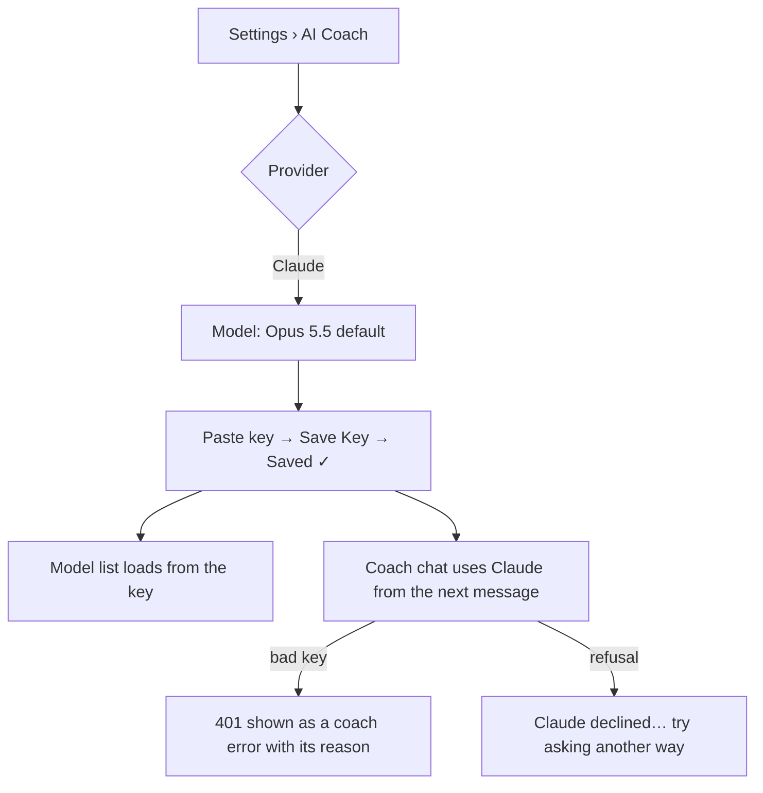

# Audit: Claude as the coach (v2.13.0)

Date: 2026-11-04 · PR: see the PR that adds this file · Auditor: Claude. The four skills were
applied by reading the code; there is no device or emulator in this session, so there are no
screenshots.

## Scope

- **New provider:** Settings › AI Coach › Provider › **Claude (Anthropic)**, with the user's own
  key. It runs on Anthropic's Messages API (`coach/anthropic/AnthropicClient.kt`).
- **Its section** follows the same pattern as Gemini and MiniMax:
  - a model picker (Opus 5.5 is the default, plus Sonnet 5.5 and Haiku 5.5, and the live list
    from `/v1/models`);
  - the shared key field;
  - one line on where to get a key and who bills for it.
- **Reasoning effort** lists Low to Max for Claude. **Web search** is hidden for Claude, as it is
  for MiniMax and Local, because the client doesn't send it.
- **No new screen and no new tokens.**

## ux-user-flows (§13 flow review checklist)

| # | Question | Result |
|---|---|---|
| 1 | Job | Use my own Claude key for the coach. Pass |
| 2 | Entries | Only the provider menu, where the other providers already are. Pass |
| 3 | Happy path | Pick Claude, paste the key, save: three actions, the same as every keyed provider. Pass |
| 4 | Branches | Default model, a preset, or one from the live list. Pass |
| 5 | States | No key, key saved (Update/Remove), list loading, list failed (falls back to the presets), retired model flagged. Pass |
| 6 | Errors | A bad key gives an HTTP 401 with its reason in the coach error. A refusal or a cut-off reply each has its own plain message. Pass |
| 7 | Control | Remove the key, switch provider; changes apply from the next message. Pass |
| 8 | Progress and resume | Not applicable |
| 9 | Memory | The key and model ride in the backup with the other providers' keys, at the owner's request; the Backup screen already warns about this. Pass |
| 10 | Exits | Back, or another provider. Pass |
| 11 | Conventions | The shared `KeyField`, `CoachModelPicker`, `PulseButton` and helper text. Pass |
| 12 | Speed | One round trip per tool step; prompt caching on; a 180 s read timeout because Opus thinks first. Pass |
| 13 | Accessibility | Unchanged components: the key field's show/hide has a label, and targets are 52dp. Pass |
| 14 | Ethics | The helper line says usage is billed to the user's Anthropic account. Health data goes to Anthropic only after the user picks it and saves a key, as with every cloud provider. Pass |
| 15 | Evidence | Unit tests on the translation (`AnthropicClientTest`); CI. Pass |

No issues.

## impeccable (native audit)

| Dimension | Score | Note |
|---|---|---|
| Accessibility | 4 | Existing labelled components only |
| Performance | 4 | Prompt caching; the request runs on IO through `ResponsesHttp` |
| Appearance & theming | 4 | No new colour or size; the helper text is `bodySmall` on `onSurfaceVariant`, like its siblings |
| Platform conformance | 4 | Password-type field with the IME Done action, as before |
| Adaptivity | 4 | One column; the pt-BR strings wrap |
| **Total** | **20/20** | |

Findings: none at P0–P2. **P3:** web search could be offered later through Claude's own server
tool, once its pairing with structured output is checked on a real key.

## graphic-design-fundamentals (§13)

| Item | Result |
|---|---|
| Brief, concept, hierarchy | Pass: provider, then model, then key, the same order as the other providers |
| Contrast, colour | Pass: no new colour; mint stays on Save Key |
| Alignment, spacing, typography | Pass: 4/8dp spacing, the type scale |
| Consistency, simplicity | Pass |
| Real size, accessibility | Pass (by reading) |
| Production | Pass: every new `tr()` key has a pt-BR entry (script-checked) |

## less-is-more

| Element | Question | Kept / cut |
|---|---|---|
| "Claude (Anthropic)" in the menu | 1 | Kept |
| Three presets with one-line blurbs | 1 | Kept: the picker needs something to show before a key exists |
| "Create a key at console.anthropic.com…" | 1 (consent: who pays) | Kept, one line |
| Web search switch | 2 (it would do nothing) | Hidden for Claude |

No other screen changed, and taps on common actions did not go up.

## Verdict

Merge. There are no P0 or P1 findings.
