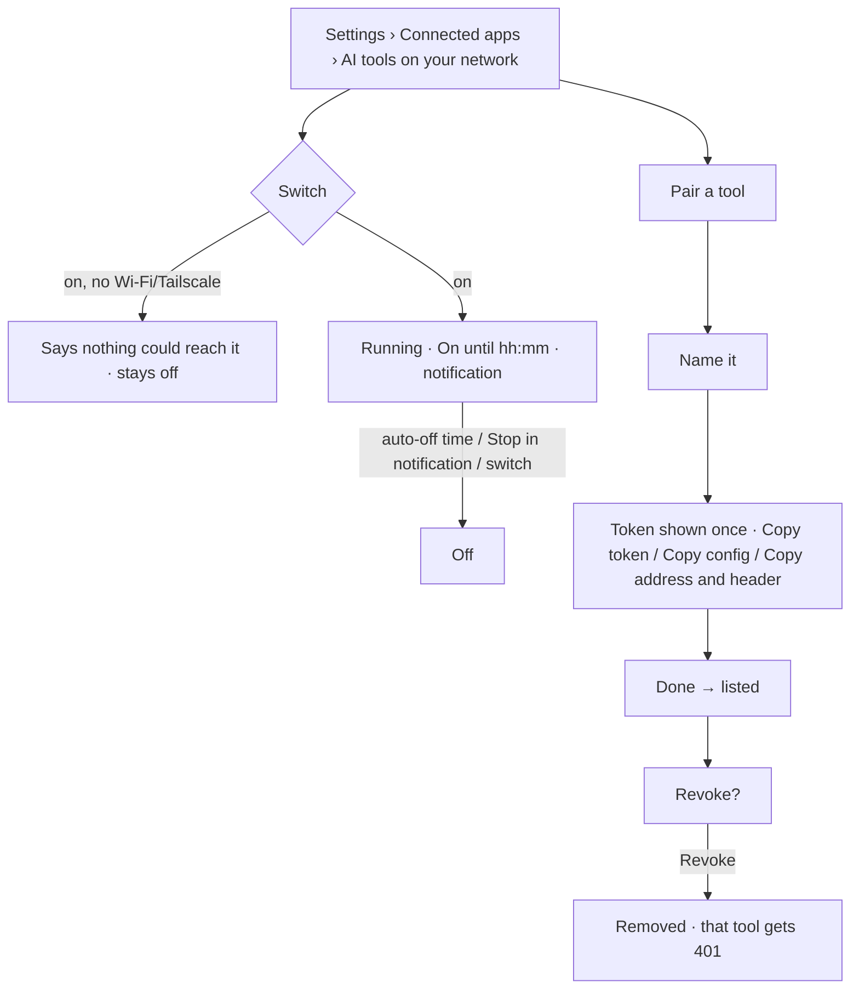

# Audit: AI tools on your network (MCP, step 2 of docs/on-device-model-and-mcp-plan.md)

Date: 2026-11-04 · PR: #65 · Auditor: Claude. The four skills were applied by reading the code;
there is no device or emulator in this session, so there are no screenshots.

## Scope

- **New screen:** Settings › Connected apps › **AI tools on your network**
  (`ui/screens/McpSettingsUi.kt`), inside the shared `SettingsSubScreen` with its centred top bar.
- **New service:** a `dataSync` foreground service with a "Tap to stop" notification on its own
  channel.
- **Settings row:** one Connected apps row, which reads "On" while the server runs.
- **No new design tokens.**

## ux-user-flows (flow map and §13 review)

| # | Question | Result |
|---|---|---|
| 1 | Job | Let my own agent read my data, and stop it easily. Pass |
| 2 | Entries | Settings › Connected apps; the notification leads back to the screen and has a Stop action. Pass |
| 3 | Steps | Turn on, pair, copy one snippet: three actions. Pass |
| 4 | States | Off, starting, running (with the off time), unreachable (no Wi-Fi or Tailscale), no pairings, paired, just paired (token shown once), revoking. Pass |
| 5 | Errors | Unreachable says why and what to do. A tool with a bad or missing token gets a 401 and never sees data. Pass |
| 6 | Exits | Back, the switch, the notification's Stop, and auto-off. Pass |
| 7 | Destructive steps | Revoke asks first. Turning it off needs no confirm, since it is the safe direction. Pass |
| 8 | Memory | The token is shown once and stored only as a hash. The screen says so: "Copy this now. It won't be shown again." Pass |
| 9 | Consent and ethics | The intro and the privacy line say plainly that paired tools can read health data while it is on, and that it is read-only. Off by default, never archived, never carried to a new phone. Pass |
| 10 | Feedback | "On until …" while running; each pairing shows when it was last used. Pass |
| 11 | Conventions | Shared top bar, switch row, eyebrows, Tonal "Pair a tool", Text buttons in dialogs. Pass |
| 12 | Performance | Addresses are read on Dispatchers.IO; calls run one at a time. Pass |
| 13 | Accessibility | The switch row is one control, rows are at least 48dp, and the token text is selectable. Pass |

## impeccable (native audit)

| Dimension | Score | Note |
|---|---|---|
| Accessibility | 4 | Switch row, 48dp rows, selectable addresses |
| Performance | 4 | Bounded server; IO off the main thread |
| Appearance & theming | 3 | Tokens only. The address list is plain monospace text, which suits it |
| Platform conformance | 3 | A foreground service with a Stop action. Android 15 caps `dataSync` at about 6 hours a day, so the 8 h choice is clipped (noted in the threat model) |
| Adaptivity | 3 | One column; long URLs wrap |
| **Total** | **17/20** | |

Findings:
- **P2:** on Android 15 the 8 h option can't last a full 8 hours. The choices or the copy could
  say so. Carried.
- **P3:** if the phone's address changes, the server must be restarted. Carried.

## graphic-design-fundamentals (§13)

| Item | Result |
|---|---|
| Brief, concept, hierarchy | Pass: the switch first, then where to connect, then pairings |
| Contrast, colour | Pass: mint only on the switch and buttons; warning colour for unreachable |
| Alignment, spacing, typography | Pass: 8/12/16dp spacing, `PulseType` roles |
| Consistency, simplicity | Pass |
| Real size, accessibility | Pass (by reading) |
| Production | Pass: every string has its pt-BR entry (script-checked) |

## less-is-more

| Element | Question | Kept / cut |
|---|---|---|
| Intro line | 1 (consent) | Kept |
| Two snippets (Claude Desktop/Cursor bridge, and plain HTTP) | 1 | Kept: different tools need different ones; both sit behind "Pair a tool" |
| "A new time applies the next time…" | 3 | Shown only while running |
| Last-used date per pairing | 1 | Kept: it is how you spot a tool you no longer use |

Common taps did not rise: nothing was added to any existing screen except one Settings row.

## Verdict

Merge. There are no P0 or P1 findings; the two carried items are above.
