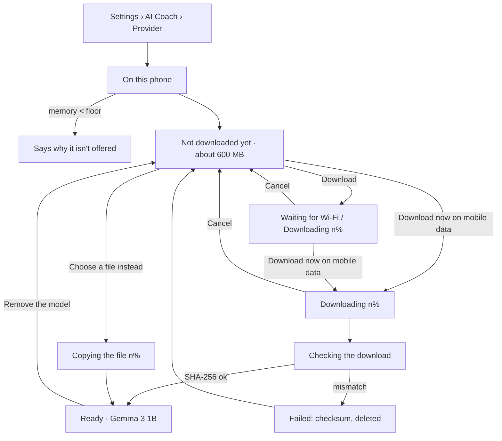

# Audit: On-device coach provider (step 1 of docs/on-device-model-and-mcp-plan.md)

Date: 2026-11-04 · PR: (to fill) · Auditor: Claude (skills applied by hand from their checklists; no device or emulator in this session, so no screenshots)

## Scope

- Settings › AI Coach: a new provider option, "On this phone (no key, works offline)", whose
  controls live in `ui/screens/OnDeviceModelUi.kt` (status, size, Download / Download now on
  mobile data, progress and Cancel, Remove, Choose a file instead, Gemma Terms of Use, memory floor).
- The AI Coach card hides switches that don't apply to this provider (image attachments, web
  search, write actions, live measurements) and the Keystore note.
- Coach header subtitle reads "On this phone · Gemma 3 1B" while this provider is chosen; the
  composer offers no attach button for it.
- Meal estimate and lab report reading say plainly that the on-device coach can't do them.

## ux-user-flows (§13 flow review checklist)

| # | Question | Result |
|---|---|---|
| 1 | Job | Get a coach that answers on the phone, with no key, then forget about it. |
| 2 | Entries | Settings › AI Coach › Provider; the coach's "Model download needed" status points there. |
| 3 | Happy path | Pick provider → Download → (Wi-Fi) → Ready. Two taps. |
| 4 | Branches | Mobile data now; choose a file; below the memory floor. |
| 5 | States | Absent, waiting for Wi-Fi, downloading, copying, checking, ready, failed (7 reasons). |
| 6 | Errors | Each failure reason has its own plain line and offers the same actions again. |
| 7 | Control | Cancel at any time during a download; Remove frees the space; the download manager's notification can cancel too. |
| 8 | Progress and resume | Percent and bar; the download manager resumes after the app closes or the link drops, and the screen picks the download back up. |
| 9 | Memory | The size is stated before anything moves; no need to remember anything. |
| 10 | Exits | Back; switching provider frees the loaded engine. |
| 11 | Conventions | Android download manager notification; SAF file picker. |
| 12 | Speed | Answers take seconds on CPU; said up front ("slower and simpler than a cloud coach"). |
| 13 | Accessibility | Every action is a PulseButton (≥ 52 dp); status is text, not colour alone. |
| 14 | Ethics | Wi-Fi only by default; Gemma licence linked before download; nothing leaves the phone. |
| 15 | Evidence | Mirrors Cochilo's shipped sheet. Not yet tried on the owner's phone. |

Issues: none critical. Polish: the Keystore note is now hidden for this provider only; fine.

## graphic-design-fundamentals (§13 checklist)

| # | Question | Result |
|---|---|---|
| 1 | Brief | One section inside the existing AI Coach card. |
| 2 | Concept | Status first, one primary action, the rest as text buttons. |
| 3 | Hierarchy | Status line 16 sp SemiBold; explanations 14 sp secondary; licence note 12 sp muted. |
| 4 | Contrast | `textPrimary` / `textSecondary` on the card; failure in `danger`, ready in `success`. |
| 5 | Alignment and grid | Single column, full-width primary button, 8 dp rhythm. |
| 6 | Spacing | 4 / 8 dp only. |
| 7 | Typography | 12 / 14 / 16 sp from `PulseType.SCALE`. |
| 8 | Colour | Mint only on buttons (the tappable thing); the progress bar uses `info`. |
| 9 | Consistency | Same card, dropdown and button styles as the other providers. |
| 10 | Simplicity | At most one Tonal button visible at a time. |
| 11 | Real-size test | Not run (no device); pt-BR labels can wrap, buttons have no fixed height. |
| 12 | Accessibility and ergonomics | Targets ≥ 48 dp; reachable one-handed in the card. |
| 13 | Production | No new tokens or assets. |

## impeccable (audit, native / Android)

| # | Dimension | Score | Key finding |
|---|---|---|---|
| 1 | Accessibility | 3 | Text states; no icon-only controls. Progress bar has no spoken value beyond the status text above it. |
| 2 | Performance | 3 | Status is a StateFlow; the 600 MB engine loads on first question and is closed on provider change or Remove. |
| 3 | Appearance & theming | 4 | Tokens only; dark theme like the rest. |
| 4 | Platform conformance | 4 | DownloadManager, SAF, no storage permission. |
| 5 | Adaptivity | 3 | Single column; not checked in landscape on a device. |
| | **Total** | **17/20** | |

Findings: P2 — speed and memory on real phones are unmeasured (try first on the owner's phone).
P3 — the canvas board for AI Coach needs the new option (see PR description).

## less-is-more

| Element | Question (1–5) | Kept / moved / merged / removed, and where |
|---|---|---|
| Intro line | 1: says what it is and what it can't do | Kept, one sentence pair. |
| Size line | 2: needed before a 600 MB download | Kept, merged with "Wi-Fi only". |
| Mobile-data choice | 3: needed when no Wi-Fi | Kept as a Text button, not a switch. |
| Choose a file | 4: rare | Kept as a Text button below. |
| Image / web / write / live switches | 5: don't apply | Removed for this provider. |

| Dimension | 0–4 |
|---|---|
| Elements per screen, compared with before | 3 (four switches hidden, one section added) |
| Duplicates left | 4 |
| Text to read when tired | 3 |
| Taps on the common actions (must not rise) | 4 (other providers unchanged) |

## Evidence

No device in this session: no screenshots, `check_tokens.py` / `drift.py` not run (no token changed).
