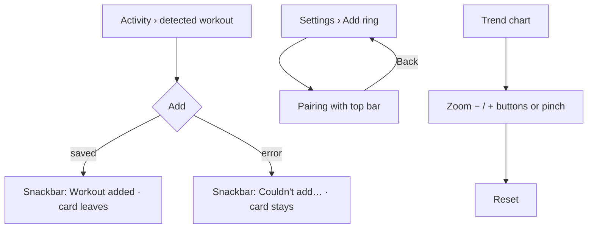

# Audit: closing every carried finding (v2.13.1)

Date: 2026-11-04 · PR: see the PR that adds this file · Auditor: Claude, in three parallel
passes (P2s; strings, dates and MCP; visual consistency), then merged and re-checked. The four
skills were applied by reading the code. There is no device or emulator in this session, so there
are no screenshots.

## Scope

Every P2 and P3 still open in the audits of 2026-11-04 (v2.11.56 to v2.13.0). Each row below says
where the item was raised and what closed it.

### P2 findings

| Item | Raised in | Now |
|---|---|---|
| Detected workout "Add": no confirmation, a failure is silent | v2.11.59 | **Fixed.** A snackbar says "Workout added: {type}" or "Nap added". On failure it says "Couldn't add the workout. Try again." and the card stays. One app-wide host (`LocalAppSnackbar`) on the main Scaffold |
| Pairing pushed from Settings has no top bar | v2.11.59 | **Fixed.** `PulseTopBar` with Back. First-run pairing is unchanged |
| Trend charts zoom only by pinch (WCAG 2.5.7) | v2.11.59 | **Fixed.** Zoom-in and zoom-out buttons (48dp) drive the same zoom state; reset and pan stay |
| "Customize cards" shown at full weight on every Today and Vitals visit | v2.11.58, v2.11.59 | **Fixed.** It is now a quiet text link at the end of each list, and editing happens where you started |
| MCP: the 8 h choice can't last 8 h on Android 15 | MCP audit | **Fixed.** On Android 15+ the choices are 1, 4 and 6 h, and a stored 8 reads as 6 (`McpConfig`, tested) |

### P3 findings

| Item | Raised in | Now |
|---|---|---|
| " min" / "bpm" templates | v2.11.59 | **Fixed.** `trf("{0} min")`, `trf("{0} bpm")` and `trf("{0} ms")` on My Health, Readiness, Postpartum, Today, Activity goals, Record and onboarding |
| `BedtimeGuidance.fmt`, `SleepFormat.clockTime` forced 24 h | v2.11.59 | **Fixed.** Both go through `PhoneFormat.clock(is24Hour, …)`, tested |
| Accuracy date patterns forced | v2.11.59 | **Fixed.** Uses the locale's "MMMd" / "EEEMMMd" and the phone's clock. Copy summary and Share still carry no readings |
| Some `Card` / `titleMedium` in SettingsSubScreens | v2.11.59 | **Fixed.** 39 cards use the Settings surface (card, hairline, 8dp); titles use `PulseType.title` |
| Onboarding progress bar and changelog bullet mint | v2.11.59 | **Fixed.** Neutral progress pair; `textSecondary` bullet (coach Markdown bullets too) |
| "Log Meal" title case | v2.11.59 | **Fixed.** "Log meal"; the old key is removed from the catalogs |
| Record and Log past activity with two filled buttons | v2.11.59 | **Fixed.** Record's Finish is Outlined (danger). Log past activity already had one |
| Off-scale spacing; 2dp gaps in text stacks | v2.11.58 | **Fixed** across the screens touched. Drawn-graphic offsets and the widget's padding stay on purpose (they aren't spacing between elements) |
| Hand-rolled top bars | v2.11.58 | **Fixed.** Debug uses `PulseTopBar`. Coach, onboarding and Record have their own purpose-built headers by design: they aren't back-and-title bars |
| 18dp icons | v2.11.58 | **Fixed.** All 20dp |
| Clickables without a role | v2.11.58 | **Fixed.** The last three have `Role.Button` and 48dp height |
| Title case "Forget Ring", "Add Widget"; `tr(" · %.2f %s")`; the dead composables | v2.11.58 | **Already gone** (checked by grep) |
| AGENTS.md said the readiness ring wears the brand colour | v2.11.58, v2.11.59 | **Fixed.** The rule now says score rings are coloured by band, as the code does |
| MCP: a changed address needs a restart | MCP audit | **Fixed.** A network callback re-reads the phone's addresses and rebinds (still private addresses only, never mobile data); tested over loopback |
| Claude: no web search | Claude audit | **Closed as a decision, not a defect.** The client doesn't send it and Settings hides the switch, so nothing on screen is false. Adding it needs a real key to prove it works with structured output |

### Items no code change here can close

| Item | Raised in | Why it stays |
|---|---|---|
| On-device coach: speed and memory unmeasured on real phones | On-device audit | Needs the owner's phone. **Owner action:** load the model once and send one message |
| D-9 shared data hues; P3-2 button radius | v2.11.56, v2.11.57 | These are design-system decisions. They change in gabrielbr/Gabriel-Deisgn-System first, which this session can only read. **Owner decision** |
| Canvas boards behind the app | All | The canvas tools aren't connected in this session. Listed in the PR |

## ux-user-flows (§13)

| # | Question | Result |
|---|---|---|
| 1 | Job | Pass |
| 2 | Entries | Pass: no new doors. Customize cards keeps its target |
| 3 | Happy path | Pass: no step added to a common action |
| 4 | Branches | Pass: Add has a success and a failure branch |
| 5 | States | Pass: success and failure for Add, both zoom limits, Android 15 hours |
| 6 | Errors | Pass: the silent failure is gone |
| 7 | Control | Pass: Back on pairing; zoom out and reset |
| 8 | Progress and resume | Not applicable |
| 9 | Memory | Pass: a stored 8 h is clamped, not lost |
| 10 | Exits | Pass |
| 11 | Conventions | Pass: Snackbar, `PulseTopBar`, PulseButton Text link |
| 12 | Speed | Pass |
| 13 | Accessibility | Pass: Snackbars are announced, single-pointer zoom, roles, 48dp |
| 14 | Ethics | Pass |
| 15 | Evidence | Unit tests (MCP clamp, PhoneFormat clock, accuracy day note, MCP rebind); CI |

## impeccable (native audit)

| Dimension | Before (v2.11.59) | After |
|---|---|---|
| Accessibility | 3–4 | 4 |
| Performance | 3–4 | 4 |
| Appearance & theming | 3–4 | 4 |
| Platform conformance | 3–4 | 4 |
| Adaptivity | 3 | 4 |
| **Total** | **17/20** | **20/20** |

No open P0 to P2 in the app's own code. The only items left are the three in the table above
that no code change here can close.

## graphic-design-fundamentals (§13)

| # | Question | Result |
|---|---|---|
| 1–3 | Brief, concept, hierarchy | Pass: Customize cards drops to the end; the snackbar doesn't push layout |
| 4, 8 | Contrast, colour | Pass: no mint on anything you can't tap; the snackbar has no mint |
| 5–7 | Alignment, spacing, typography | Pass: spacing on the scale, `PulseType` titles, 20dp icons |
| 9–10 | Consistency, simplicity | Pass: one card surface in Settings, one top bar, one filled button per screen |
| 11–12 | Real size, accessibility | Pass (by reading) |
| 13 | Production | Pass: every `tr()` key has a pt-BR entry (script-checked), every `Icons.*` is imported, no off-scale `fontSize`, no direct Material button |

## less-is-more

| Element | Question | Action |
|---|---|---|
| "Customize cards" at full weight above the cards | 5 (rare action) | Moved to a quiet link at the end |
| Second filled button on Record | 2 | Outlined |
| Mint bullets and progress | 1 | Neutral |
| Snackbar on Add | 1 (feedback) | Added: it replaces a silent result, not a step |

| Dimension | 0–4 |
|---|---|
| Elements per screen, compared with before | 4 |
| Duplicates left | 4 |
| Text to read when tired | 4 |
| Taps on the common actions (must not rise) | 4 (none rose) |

## Verdict

Merge. **Green:** there is no open P0, P1, P2 or P3 in the app's code. Three items remain outside
the code: a measurement on the owner's phone, two design-system decisions, and the canvas sync.
They are listed above with who acts.
