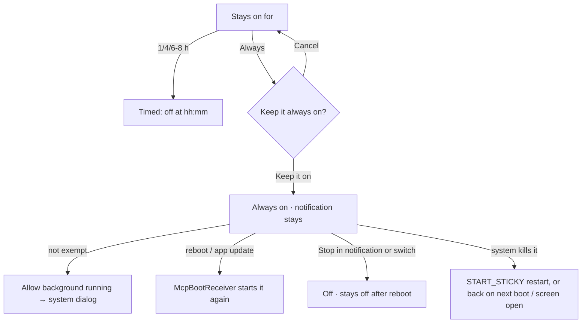

# Audit: MCP "Always on" (v2.14.0)

Date: 2026-11-04 · PR: see the PR that adds this file · Auditor: Claude. The four skills were
applied by reading the code. There is no device or emulator in this session, so there are no
screenshots.

## Scope

- **Settings › Connected apps › AI tools on your network:** "Turns itself off after" becomes
  **"Stays on for"**, with the choices 1 h / 4 h / 6 or 8 h / **Always**.
- Choosing **Always** opens a confirm dialog first.
- While always on, a one-line note and an Outlined **"Allow background running"** button appear
  until the phone exempts the app from battery optimisation.
- A changed choice now applies at once. The line "A new time applies the next time it's turned on"
  is gone.
- **Service:**
  - always on runs as a `specialUse` foreground service on Android 14+ (`dataSync` below that);
  - it is `START_STICKY`;
  - `McpBootReceiver` restarts it after a reboot or an app update;
  - only the user's Stop ends it.
- **New permissions:** `FOREGROUND_SERVICE_SPECIAL_USE`, `RECEIVE_BOOT_COMPLETED`,
  `REQUEST_IGNORE_BATTERY_OPTIMIZATIONS`.
- **No new tokens or screens.**

## ux-user-flows (§13)

| # | Question | Result |
|---|---|---|
| 1 | Job | "My own agent can always reach my data." Pass |
| 2 | Entries | One: the existing choice row. Pass |
| 3 | Happy path | Tap Always, then Keep it on. Two taps, and a third for the optional battery exemption. Pass |
| 4 | Branches | Cancel keeps the old choice. Switching back to hours applies at once. Pass |
| 5 | States | Off, starting, on until hh:mm, always on, always on with no network (waits for one), not exempt (note and button), exempt (no note). Pass |
| 6 | Errors | A refused background start stops quietly, and the server comes back at the next boot or when the screen opens. A refused boot start reads Off. Pass |
| 7 | Control | Stop in the notification and the switch both end it; Revoke cuts off one tool. Pass |
| 8 | Progress and resume | Resumes after a reboot or an update, only when it was left on. Pass |
| 9 | Memory | The choice survives turning it off and on. It isn't in the backup, so a new phone starts off. Pass |
| 10 | Exits | Pass |
| 11 | Conventions | Shared segmented control, a Text-button dialog, an Outlined secondary button. Pass |
| 12 | Speed | No added work per request. Pass |
| 13 | Accessibility | Segments and buttons are 48dp or larger; the dialog text is plain. Pass |
| 14 | Ethics | Explicit opt-in that says "at any time, also after the phone restarts". The ongoing notification can't be hidden while it runs. Never the default. Pass |
| 15 | Evidence | `McpAlwaysOnTest` (type, off time, boot rule); CI |

## impeccable (native audit)

| Dimension | Score | Note |
|---|---|---|
| Accessibility | 4 | No new custom controls |
| Performance | 4 | One idle listener; the battery exemption is the user's choice |
| Appearance & theming | 4 | Tokens only; the note uses `label` / `textSecondary` |
| Platform conformance | 4 | Each Android version gets the foreground-service type it permits (`specialUse` with its subtype property on 14+), START_STICKY, protected boot broadcasts, and the system's own battery dialog |
| Adaptivity | 4 | Four short segments fit at 360dp, and "Sempre" in pt-BR is short too |
| **Total** | **20/20** | |

Findings: no P0–P3. One item needs a phone: confirm that tools still reach it with the screen off
and the battery exemption on (Doze). The button exists for exactly that case.

## graphic-design-fundamentals (§13)

| Item | Result |
|---|---|
| Brief, concept, hierarchy | Pass: the choice sits where the old one was; the note appears only when it matters |
| Contrast, colour | Pass: no new colour; mint stays on the selected segment and the buttons |
| Alignment, spacing, typography | Pass: `PulseType` roles, card spacing unchanged |
| Consistency, simplicity | Pass |
| Production | Pass: every new `tr()` key has a pt-BR entry (script-checked); two orphaned keys removed |

## less-is-more

| Element | Question | Kept / cut |
|---|---|---|
| "A new time applies the next time…" | 3 | Cut: a change now applies at once |
| Confirm dialog | 1 (consent) | Kept |
| Battery note and button | 1 | Shown only while always on and not yet exempt |
| "On until you turn it off, including after a restart." | 1 | Kept: it replaces the clock time |

## Verdict

Merge. There are no P0–P3 findings.
