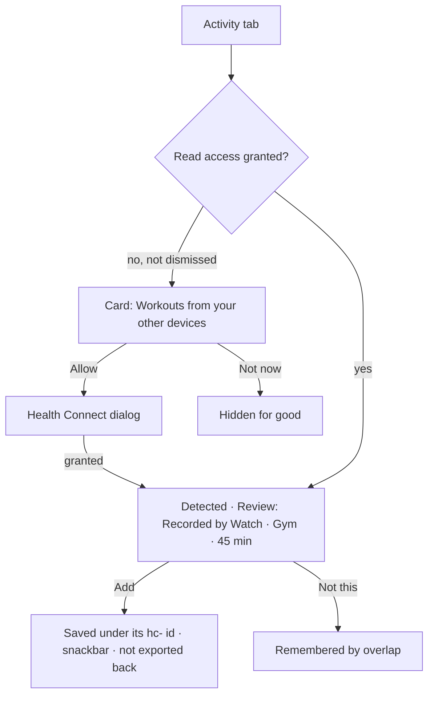

# Audit: workouts from other devices, and a heart rule for a 5-minute grid (v2.15.0)

Date: 2026-11-05 · PR: see the PR that adds this file · Auditor: Claude, by reading the code. There
is no device or emulator in this session, so there are no screenshots.

## Scope

- **Activity tab:** a one-time card, "Workouts from your other devices", with two buttons: Allow
  (Tonal, which opens the Health Connect permission dialog) and Not now (Text).
- After that, workouts another app saved to Health Connect show in the existing Detected card,
  labelled "Recorded by {app}", with their own type selected.
- **Detection:** the heart-rate rule is retuned (`ActivityDetection.heartSessions`).
- **No new screen, no new tokens.**

## ux-user-flows (§13)

| # | Question | Result |
|---|---|---|
| 1 | Job | "The workout my watch recorded shows up in PulseLoop." Pass |
| 2 | Entries | Activity tab, plus the existing post-sync notification. Pass |
| 3 | Happy path | Allow once, then one tap per workout. Pass |
| 4 | Branches | Allow, Not now, permission denied (the card stays until dismissed), source mode (the card is hidden because that mode already imports workouts). Pass |
| 5 | States | Prompt, granted, nothing found, found, added, dismissed. Pass |
| 6 | Errors | A Health Connect read failure falls back to the ring's own detection, silently. Pass |
| 7 | Control | Nothing is saved without a tap; "Not this" holds. Pass |
| 8 | Progress and resume | Not applicable |
| 9 | Memory | The dismissal is remembered; an added workout is never offered again (overlap with recorded sessions). Pass |
| 10 | Exits | Pass |
| 11 | Conventions | The same Detected card, chips, `PulseButton` and snackbar. Pass |
| 12 | Speed | One Health Connect read of at most 3 days, off the main thread. Pass |
| 13 | Accessibility | Existing components; button targets are 52dp. Pass |
| 14 | Ethics | The read is asked for, explained in one sentence, and refusable. No write-back under PulseLoop's name. Pass |
| 15 | Evidence | `WorkoutDetectionTest` (strength pattern, calm hour, long rest, reading gap, steady cardio, the device's type and id, the overlap rule); CI |

## impeccable (native audit)

| Dimension | Score | Note |
|---|---|---|
| Accessibility | 4 | No custom controls |
| Performance | 4 | Bounded read: 3 days, at most 5 pages |
| Appearance & theming | 4 | Card surface, `PulseType` roles, Tonal and Text buttons |
| Platform conformance | 4 | Health Connect's own permission contract, plus background read for notifications |
| Adaptivity | 4 | The buttons sit in a FlowRow, so pt-BR wraps |
| **Total** | **20/20** | |

Findings: no P0–P3.

## graphic-design-fundamentals (§13)

| Item | Result |
|---|---|
| Hierarchy | Pass: the prompt is one card above Detected, shown once |
| Colour | Pass: no new colour |
| Typography and spacing | Pass: `PulseType` title and body, 8dp gaps |
| Production | Pass: every `tr()` key has a pt-BR entry (script-checked) |

## less-is-more

| Element | Question | Kept / cut |
|---|---|---|
| Permission card | 1 (consent) | Kept; one sentence; gone once answered |
| "Recorded by {app}" | 1 | Kept: it says why this suggestion is trustworthy |
| A separate screen for imports | 2 | Cut: the existing Detected card is the one place to answer |

## Verdict

Merge. There are no P0–P3 findings.
